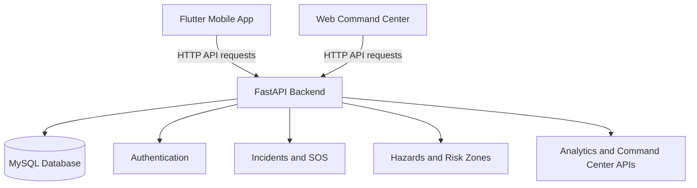

# MoDoNER --- Tourist Safety Grid

A connected safety platform designed to help tourists stay informed and
help response teams maintain better visibility of reported incidents,
hazards, and area-level risk.

MoDoNER brings together a **Flutter mobile application**, a **FastAPI
backend**, and a **web-based Command Center**. The system is being
developed as a team-built software product, with an emphasis on
practical safety workflows, resilient incident reporting, and
operational visibility.

> **Project status:** Active development. This repository contains the
> current application implementation. Some resilience and predictive
> capabilities remain under development and are identified separately
> below.

---

## Contents

- [Overview](#overview)
- [What the system includes](#what-the-system-includes)
- [Architecture](#architecture)
- [Technology stack](#technology-stack)
- [Repository layout](#repository-layout)
- [Getting started](#getting-started)
  - [Prerequisites](#prerequisites)
  - [1--backend](#1--backend)
  - [2--command-center](#2--command-center)
  - [3--mobile-application](#3--mobile-application)
- [Configuration and networking](#configuration-and-networking)
- [API documentation](#api-documentation)
- [Current scope and future work](#current-scope-and-future-work)
- [Screenshots](#screenshots)
- [Contributing](#contributing)
- [Team](#team)
- [Disclaimer](#disclaimer)

---

## Overview

Tourists may encounter unfamiliar routes, local hazards, connectivity
limitations, or situations where communicating an incident quickly is
difficult. At the same time, response teams need a clearer view of
incoming reports and the locations where attention may be required.

MoDoNER is being built to connect these two sides:

- A mobile experience for users to access safety-related information
  and report incidents.
- A backend that manages authentication, incident data, hazard
  information, and risk-zone data.
- A Command Center that gives authorized operators a consolidated view
  of safety activity and operational information.

The goal is to move beyond a standalone panic button toward a connected
safety workflow.

## What the system includes

### Mobile application

The Flutter application includes the following implemented application
areas:

- **User authentication** --- registration, login, and authenticated
  application access.
- **SOS incident reporting** --- submit an emergency incident with
  associated information.
- **Location services and map** --- location-aware functionality and
  map-based views.
- **Hazard information** --- access hazard-related information.
- **Risk-zone information** --- view area-level risk-zone data
  supplied by the backend.
- **User profile** --- access profile-related information.

The codebase also contains supporting components for offline SOS
storage, SMS fallback, and SOS audio handling. Their behaviour and
device/network compatibility should be validated in the target
environment before relying on them in a real emergency.

### Backend API

The backend is built with FastAPI and provides application services for:

- Authentication and user access.
- Incident creation and incident-related operations.
- Hazard data.
- Risk-zone data.
- Command Center and analytics data.
- Database access and schema migrations.

SOS creation uses a client-generated `local_incident_id` to support
idempotent submission: submitting the same local incident identifier
again should not create a duplicate incident.

### Command Center

The web-based Command Center is intended for authorized operational
users. Its current codebase includes:

- A dashboard application built with React and TypeScript.
- API service integration.
- Map-related dependencies and visualization components.
- Analytics and chart components.

The exact operational workflows available in a running deployment depend
on the configured backend and the current integration state.

---

## Architecture



**Typical data flow**

1.  A user interacts with the mobile application.
2.  The application sends an authenticated request to the backend.
3.  The backend validates the request and performs the relevant
    operation.
4.  Application data is stored or retrieved through the database layer.
5.  The Command Center consumes backend data to present operational
    information.

---

## Technology stack

Layer Technologies

---

Mobile Flutter, Dart
Backend Python, FastAPI, SQLAlchemy, Pydantic
Database MySQL, PyMySQL
Database migrations Alembic
Web Command Center React, TypeScript, Vite
Mapping Flutter Map / Leaflet ecosystem
Authentication JWT-based authentication
API communication HTTP / JSON

---

## Repository layout

```text
MoDoNER/
├── backend/
│   ├── alembic/              # Database migrations
│   ├── app/
│   │   ├── api/              # API route modules
│   │   ├── core/             # Configuration and security
│   │   ├── database/         # Database connection and dependencies
│   │   ├── models/           # Database models
│   │   ├── schemas/          # Request/response schemas
│   │   └── services/         # Application services
│   ├── scripts/
│   ├── tests/
│   └── requirements.txt
│
├── command-center/
│   ├── public/
│   ├── src/
│   │   ├── api/              # Backend API integration
│   │   ├── components/       # UI and chart components
│   │   └── ...
│   ├── package.json
│   └── .env.example
│
├── mobile/
│   ├── android/
│   ├── ios/
│   ├── lib/
│   │   ├── core/
│   │   ├── features/
│   │   ├── models/
│   │   └── services/
│   └── pubspec.yaml
│
├── tests/
└── .gitignore
```

Generated folders such as `.venv`, `node_modules`, `build`, and `dist`
are intentionally excluded from this overview.

---

## Getting started

The instructions below describe a local development setup. Exact
environment-variable names and required values should be taken from the
configuration files in each application; do not commit real credentials.

### Prerequisites

Install the following tools:

- **Python 3.12**
- **MySQL Server** and a database client such as MySQL Workbench
- **Node.js** and npm
- **Flutter SDK** (with Dart)
- **Android Studio** and an Android emulator or physical Android
  device, if running the mobile app on Android
- **Git**

Clone the repository:

```bash
git clone https://github.com/Utkarshrana2903/smart-tourist-safety-management-app.git
cd smart-tourist-safety-management-app
```

### 1 --- Backend

Open a terminal in the repository root, then:

```powershell
cd backend

python -m venv .venv
.\.venv\Scripts\Activate.ps1

python -m pip install --upgrade pip
pip install -r requirements.txt
```

Create a local `backend/.env` file and configure the database connection
and other settings expected by the backend configuration. Use your own
local credentials.

Make sure the MySQL server is running and that the configured database
exists. Apply migrations if the project's migration setup is configured
for your database:

```powershell
alembic upgrade head
```

Start the API from the `backend` directory:

```powershell
uvicorn app.main:app --host 0.0.0.0 --port 8000 --reload
```

The API should be available at:

- Base URL: `http://127.0.0.1:8000`
- Interactive API documentation: `http://127.0.0.1:8000/docs`
- Health check: `http://127.0.0.1:8000/health`

Keep the backend terminal running while using the mobile app or Command
Center.

### 2 --- Command Center

Open a second terminal:

```powershell
cd command-center
npm install
```

Create `command-center/.env.local` using `command-center/.env.example`
as the reference. Set the backend API address according to the variable
names documented in that example file.

Start the development server:

```powershell
npm run dev
```

Vite will print the local URL in the terminal. Open that URL in your
browser.

For a production build:

```powershell
npm run build
```

### 3 --- Mobile application

Open a third terminal:

```powershell
cd mobile
flutter pub get
flutter run
```

To build a debug Android APK:

```powershell
flutter build apk --debug
```

The generated APK is normally written to:

```text
mobile/build/app/outputs/flutter-apk/app-debug.apk
```

---

## Configuration and networking

The mobile application and Command Center must point to a backend
address that they can reach.

- When the client and backend run on the same computer, a loopback
  address such as `127.0.0.1` may be appropriate for a browser-based
  client.
- An Android emulator may require a host address that is reachable
  from the emulator rather than the computer's loopback address.
- A physical phone and the development computer generally need to be
  on the same network, with the backend listening on an accessible
  interface. Configure the phone's API base URL with the development
  computer's LAN IP address.
- For local HTTP development on Android, Android cleartext-traffic
  configuration may be required if the app is not using HTTPS.

Do not hard-code a personal LAN IP address into shared project
documentation or commit private deployment credentials. Use
environment-specific configuration.

**Security note:** `--host 0.0.0.0` makes the development server listen
on network interfaces. Use it only on a trusted development network.
Production deployments should use HTTPS, secure secrets management, and
an appropriately configured server.

---

## API documentation

When the backend is running, FastAPI provides interactive API
documentation at:

```text
http://127.0.0.1:8000/docs
```

Use the interactive documentation to inspect the routes, request
schemas, response formats, and authentication requirements exposed by
the current backend.

---

## Current scope and future work

MoDoNER is under active development. The following distinction is
intentional.

### Current implementation areas

- Flutter mobile application with authentication and safety-related
  screens.
- FastAPI backend with MySQL persistence.
- Incident/SOS submission with duplicate-submission protection using a
  client-generated incident identifier.
- Hazard and risk-zone API modules.
- Web-based Command Center codebase with API integration and
  visualization components.

### Future work

- Offline machine-learning-based route-risk prediction using
  appropriately prepared and validated data.
- Further resilience improvements for low-connectivity environments.
- More complete validation of fallback communication workflows across
  supported devices and network conditions.
- Expanded operational workflows, testing, and deployment hardening.

**Machine-learning route-risk prediction is not currently presented as
an implemented feature.** It is a planned direction that requires data
preparation, model development, and evaluation before it can be relied
upon.

---

## Contributing

Contributions, suggestions, and bug reports are welcome.

1.  Fork the repository.

2.  Create a branch for your change:

    ```bash
    git checkout -b feature/your-feature-name
    ```

3.  Make focused changes and test them locally.

4.  Commit with a clear message:

    ```bash
    git add .
    git commit -m "Add: describe your change"
    ```

5.  Push your branch and open a Pull Request describing the change.

Please do not commit `.env` files, passwords, API keys, signing
credentials, generated build output, or private user data. Use example
configuration files with placeholder values where appropriate.

---

## Team

MoDoNER is developed and maintained by a team of four.

---

Team member GitHub

---

**Team Lead** https://github.com/Utkarshrana2903

**Teammate 2** https://github.com/vaibhavtrehan

**Teammate 3** https://github.com/utkarshtiwari2274-lab

**Teammate 4** https://github.com/utkarsh27275

---

---

## Disclaimer

MoDoNER is an actively developed software project. It is not a certified
emergency-response service and should not be treated as a replacement
for local emergency numbers, official authorities, or established safety
procedures. Do not rely on an unverified feature or development
deployment during an actual emergency.
